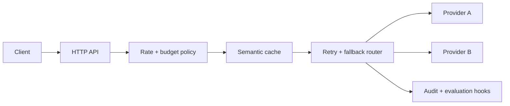

# model-router

A small gateway for keeping model calls predictable in production.

It puts one boundary around providers, retries, tenant budgets, redaction, caching, audit events, and output validation. The repository ships with a deterministic local provider; tests and the demo need no API keys.

## What works

- ordered provider fallback with bounded exponential retry
- completion and streaming interfaces
- per-tenant request limits and daily cost budgets
- request-level cost ceilings
- tenant- and model-isolated semantic cache with TTL and eviction
- structured JSON output validation
- API key, email, and payment-card redaction before provider calls
- audit sinks, evaluation hooks, request IDs, and in-process metrics
- health, readiness, completion, metrics, and cache administration endpoints
- a small TypeScript client

## Shape



Provider adapters are deliberately interfaces, not vendor SDK wrappers. Applications decide which SDK versions and credentials they trust. Persistent quota state and distributed cache coordination are deployment concerns and are not hidden behind the in-memory reference implementations.

## Run it

```sh
npm ci
npm test
docker compose up --build
```

```sh
curl http://localhost:8080/v1/chat/completions \
  -H 'content-type: application/json' \
  -H 'x-request-id: demo-1' \
  -d '{"tenantId":"demo","model":"local","messages":[{"role":"user","content":"hello"}],"maxCostUsd":0}'
```

Admin endpoints require `Authorization: Bearer $ADMIN_TOKEN`. The Compose token is only for local use.

## Library use

```ts
const router = new ModelRouter([primary, fallback], {
  policies: new PolicyStore({
    requestsPerWindow: 120,
    windowMs: 60_000,
    dailyBudgetUsd: 25,
  }),
});

const result = await router.complete({
  tenantId: "acme",
  model: "support-fast",
  messages: [{role: "user", content: "Where is order 42?"}],
  maxCostUsd: 0.04,
});
```

See the tests for failure, fallback, quota, schema, privacy, streaming, and HTTP examples.
